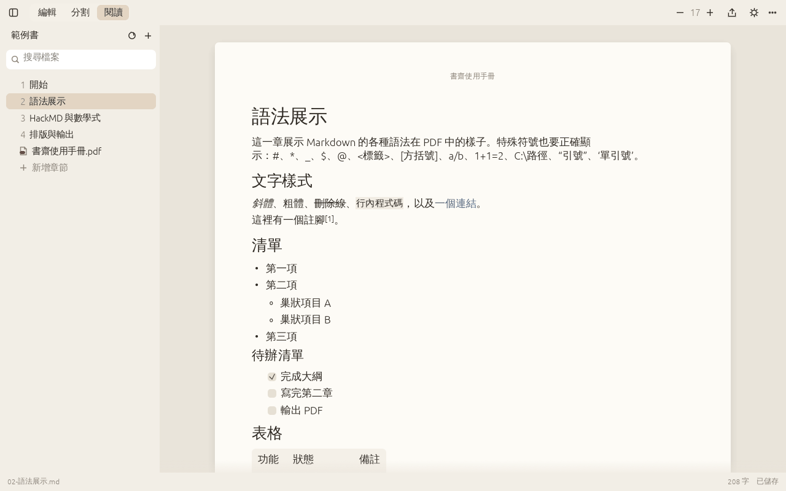
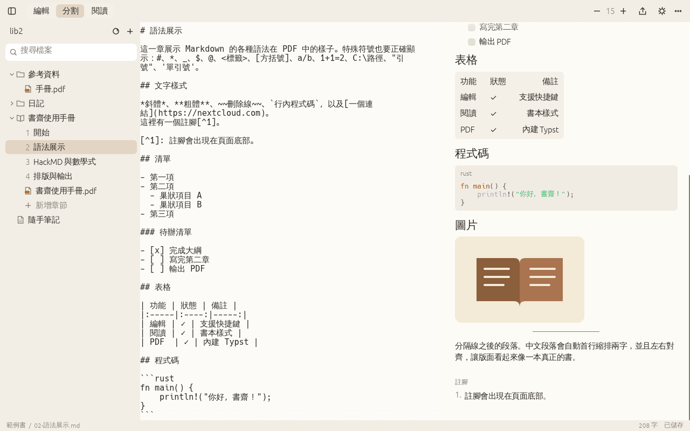
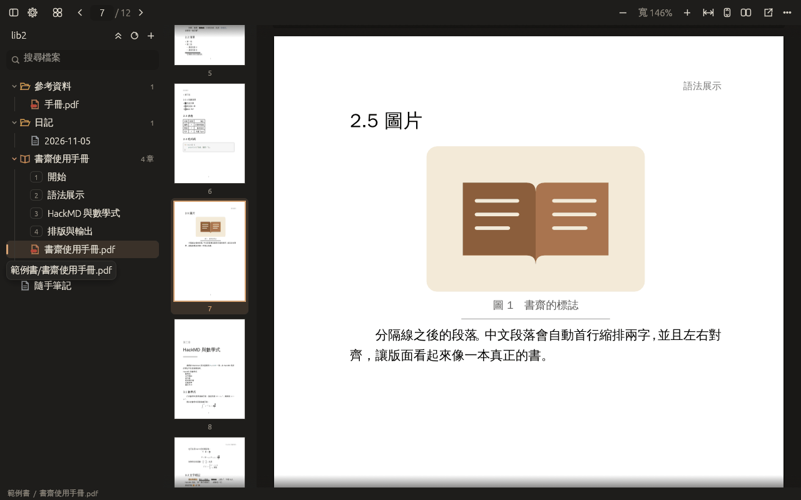
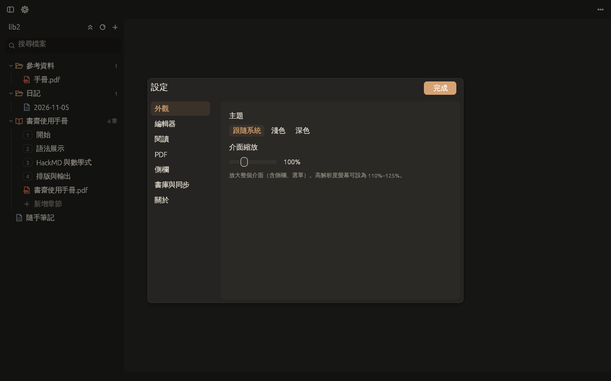
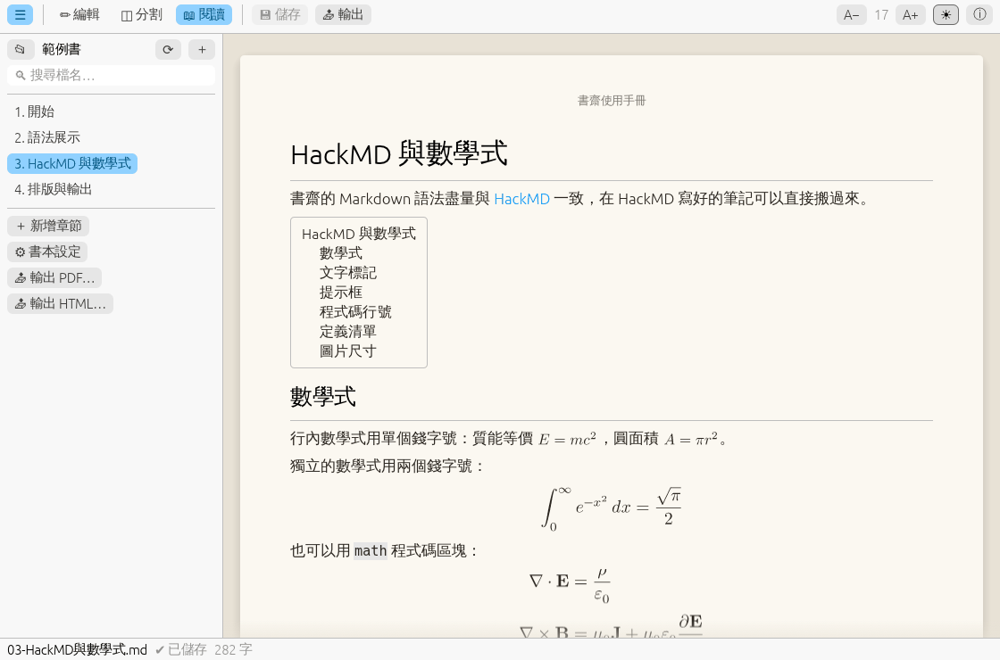
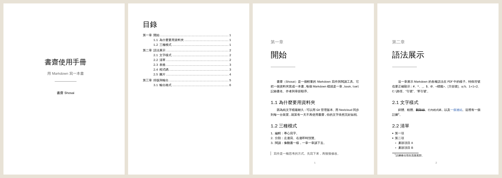

<p align="center"></p>

# 書齋 Shosai

用 Rust 寫的**輕量 Markdown 寫作與閱讀器**：把資料夾整理成一本書，像翻書一樣閱讀，一鍵排版成 PDF。

- **啟動快**：原生 GUI（egui + OpenGL），沒有瀏覽器核心；從啟動到第一個畫面約 70 ms
- **三種模式**：編輯／分割（即時預覽）／閱讀（書本頁面、上一章／下一章）
- **整理成書**：一個資料夾＋`book.toml` 就是一本書，章節可排序、改名、移到回收桶
- **輸出 PDF**：內建 [Typst](https://typst.app) 排版引擎，含封面、目錄、「第一章」章名頁、頁首、頁碼、註腳、圖說，不必另外安裝任何軟體
- **檢視 PDF**：側欄會列出書庫中的 PDF，可直接在書齋裡閱讀：頁面縮圖、輸入頁碼跳頁、符合寬度／整頁、雙頁並排，並記住上次讀到哪一頁
- **輸出 HTML**：單一檔案、圖片內嵌，瀏覽器可直接閱讀或列印
- **Nextcloud 同步**（實驗性）：透過 WebDAV 雙向同步，衝突時兩份都保留
- **LaTeX 數學式與 HackMD 語法**：`$...$`、`$$...$$`、`:::info` 提示框、`==螢光==`、`[TOC]`… 在 HackMD 寫的筆記可以直接搬過來
- **中文優先**：中文字型依需求從系統載入、段落首行縮排、中文換行不多出空白

| 閱讀模式 | 分割模式 |
|---|---|
|  |  |

檢視 PDF（左側為頁面縮圖，工具列可輸入頁碼）：



設定（左上角齒輪，或 Ctrl+,）：



HackMD 語法與 LaTeX 數學式（閱讀模式）：



輸出的 PDF（A5，封面 → 目錄 → 章節）：



## 安裝與編譯

需要 Rust 1.95 以上。

```bash
cargo build --release
```

Windows 版的 exe 會內嵌程式圖示與版本資訊（`crates/shosai/build.rs`，圖示原始檔為 `crates/shosai/assets/shosai.svg`）。

執行檔在 `target/release/shosai`（Windows 為 `target\release\shosai.exe`），單一檔案、可直接複製使用。

> **Windows 注意**：命令提示字元（cmd）不認得 `./` 開頭的路徑，要用反斜線：
>
> ```bat
> .\target\release\shosai.exe examples\範例書
> ```
>
> 或直接把 `examples\範例書` 資料夾拖到 `shosai.exe` 上。

可選功能（cargo features）：

| feature | 預設 | 說明 |
|---|---|---|
| `pdf` | ✅ | 內嵌 Typst PDF 引擎。關閉後執行檔較小，輸出 PDF 改呼叫系統的 `typst` 指令，但預覽畫面無法顯示數學式 |
| `bundled-fonts` | | 把 Typst 內建字型（約 10 MB）編進執行檔，適合沒有字型的伺服器／容器 |
| `nextcloud` | | Nextcloud／WebDAV 同步 |

```bash
cargo build --release --features nextcloud          # 加上 Nextcloud 同步
cargo build --release --no-default-features         # 最小版本（無內嵌 PDF 引擎）
```

Linux 執行時需要 `libxkbcommon-x11`（大多數桌面環境已內建）。

## 使用方式

```bash
shosai                       # 開啟上次的書庫
shosai ~/Notes               # 以資料夾為書庫開啟
shosai ~/Notes/日記.md        # 直接開啟檔案
```

也可以把資料夾、`.md` 或 `.pdf` 檔拖曳進視窗。

| 快捷鍵 | 功能 |
|---|---|
| `Ctrl+S` | 儲存（停止輸入 1.2 秒後也會自動儲存） |
| `Ctrl+N` | 新增筆記 |
| `Ctrl+1` / `2` / `3` | 編輯／分割／閱讀模式 |
| `Ctrl+B` | 顯示／隱藏側欄 |
| `Ctrl+,` | 設定 |
| `Ctrl+G` | 檢視 PDF 時輸入頁碼跳頁 |
| `Home` / `End` | 檢視 PDF 時到第一頁／最後一頁 |
| `Ctrl+=` / `Ctrl+-` | 放大／縮小字體（編輯與閱讀分開記憶）；檢視 PDF 時為縮放 |
| `←` / `→` | 閱讀模式翻到上一章／下一章；檢視 PDF 時翻頁 |

側欄的項目按**右鍵**可以重新命名、移到回收桶、調整章節順序、開啟書本設定、輸出 PDF。
書本底下會列出章節（依 `book.toml` 順序），以及書本資料夾中的 PDF（例如輸出的成品），點一下就能檢視。

檔案樹用顏色區分類型（資料夾黃、書本橘、Markdown 藍、PDF 紅），展開的資料夾有縮排導引線，
資料夾與書本旁顯示檔案數量，書本章節以編號標示順序。

**檢視 PDF**：左側縮圖列可點選跳頁；工具列有上一頁／下一頁、頁碼輸入框（輸入後按 Enter，或 `Ctrl+G`）、
縮放選單（符合寬度、整頁顯示、50%–300%）、雙頁並排（第一頁單獨當封面）。每份 PDF 會記住上次讀到的頁數。
PDF 使用純 Rust 的 [hayro](https://github.com/LaurenzV/hayro) 在背景執行緒渲染（Typst 本身也用它），只渲染畫面附近的頁面。
目前不支援文字選取，也無法開啟有密碼保護的 PDF，這時可按工具列的「用預設程式開啟」。

**設定**（左上角齒輪、`Ctrl+,`）：主題、介面縮放、編輯器字級與字型、自動儲存間隔、閱讀字級與版面寬度、
PDF 預設縮放與縮圖列、側欄顯示選項、書庫與 Nextcloud 同步。調整會立即套用並自動保存。

### 命令列（無視窗）

適合在 homelab 上自動化，例如每晚把書重新排版成 PDF：

```bash
shosai export ~/Notes/我的書                      # → ~/Notes/我的書/<書名>.pdf
shosai export ~/Notes/我的書 -o book.html         # 依副檔名輸出 .pdf / .html / .typ
shosai export 筆記.md -o 筆記.pdf                  # 單一檔案
shosai new-book ~/Notes/新書 "書名"
shosai sync ~/Notes                               # Nextcloud 同步（需 nextcloud 功能）
```

## 書本格式

一本書就是一個含有 `book.toml` 的資料夾，裡面的每個 Markdown 檔是一章（子資料夾也可以）。
`chapters` 沒列到的檔案會依檔名自然排序接在最後。範例見 [`examples/範例書`](examples/範例書)。

```toml
title = "我的第一本書"
subtitle = "副標題"
author = "作者"
language = "zh-TW"
chapters = ["01-序章.md", "02-旅程.md"]

[layout]
paper = "a5"          # a4 / a5 / b5 / a6 / letter
font_size = 10.5      # pt
line_height = 1.8
indent = true         # 段落首行縮排兩字
numbered = true       # 第一章、1.1 …
cover = true          # 封面
toc = true            # 目錄
toc_depth = 2
fonts = ["Noto Serif CJK TC", "Source Han Serif TC", "PingFang TC", "Microsoft JhengHei"]
```

章節標題取自檔案中第一個 `# 一級標題`，沒有的話用去掉編號的檔名（`01-序章.md` → 序章）。
在 Markdown 中寫 `<!-- pagebreak -->` 可以強制換頁。

## Markdown 語法（與 HackMD 相容）

書齋的語法盡量與 [HackMD](https://hackmd.io) 一致。GUI 預覽、閱讀模式、PDF、HTML 共用同一個解析器，
所以四個地方顯示的結果一致。完整示範見 [`examples/範例書/03-HackMD與數學式.md`](examples/範例書/03-HackMD與數學式.md)。

| 語法 | 寫法 |
|---|---|
| 行內數學式 | `$E = mc^2$` |
| 獨立數學式 | `$$ ... $$` 或 ` ```math ` 程式碼區塊 |
| 螢光筆／插入（底線） | `==重點==`、`++新增++` |
| 上標／下標／刪除線 | `x^2^`、`H~2~O`、`~~刪除~~` |
| 提示框 | `:::info`、`:::success`、`:::warning 標題`、`:::danger` … `:::` |
| 摺疊區塊 | `:::spoiler 標題` … `:::` |
| 目錄 | 單獨一行 `[TOC]` |
| 表情符號 | `:smile:` `:rocket:` |
| 圖片尺寸 | ``、`=200x100`、`=x100` |
| 程式碼行號 | ` ```js= `（從 1 開始）、` ```js=101 `（從 101 開始） |
| 定義清單 | `名詞` 換行 `: 解釋` |
| 嵌入影片 | ``（轉成連結） |
| 換行 | 與 HackMD 相同，**單一換行就換行**；front matter 寫 `breaks: false` 可關閉 |

另外也支援：標題、粗斜體、行內程式碼、連結、圖片（PNG/JPG/GIF/SVG/WebP）、清單（含巢狀、待辦清單，
預覽中可直接勾選）、引言、GitHub 提示 `> [!NOTE]`、表格（含對齊）、程式碼語法標示、分隔線、註腳、YAML front matter。

**數學式**以 LaTeX 撰寫，透過 [MiTeX](https://github.com/mitex-rs/mitex) 轉成 Typst 排版：
PDF 中是向量數學式，GUI 與 HTML 則顯示為 SVG。常用的分數、根號、積分、矩陣、`cases`、`aligned`、
希臘字母、`\mathbb`、`\text{中文}` 等都支援；無法排版的式子會以紅字顯示原始 LaTeX，不會讓整份 PDF 失敗。
數學字型 New Computer Modern Math 已內建，不需另外安裝。

尚未支援（會以程式碼區塊顯示）：`mermaid`、`sequence`、`flow`、`graphviz`、`abc` 等圖表。

> **字型**：PDF 會依序嘗試 `fonts` 中的字型，找不到時自動退回系統中任何有該字的字型。
> 想要好看的中文 PDF，建議安裝思源宋體／Noto Serif CJK TC。

## 與 Nextcloud 整合

有兩種方式：

**方式一：Nextcloud 桌面同步用戶端（最簡單，現在就能用）**
用官方用戶端把雲端資料夾同步到本機，再用書齋開啟那個資料夾即可。
書齋在視窗重新取得焦點時會檢查檔案是否被外部修改，沒有未儲存的內容就自動重新載入。

**方式二：書齋內建 WebDAV 同步（實驗性，`--features nextcloud`）**

1. Nextcloud →「個人設定 → 安全性」→ 建立**應用程式密碼**
2. 在書齋側欄按 ☁（右鍵 →「同步設定」），填入伺服器網址、帳號、應用程式密碼與雲端資料夾
   — 或手動建立 `<書庫>/.shosai/nextcloud.toml`：

   ```toml
   server = "https://cloud.example.com"   # 可含子路徑，如 https://nas.lan/nextcloud
   user = "alice"
   app_password = "xxxxx-xxxxx-xxxxx-xxxxx-xxxxx"   # 或改用環境變數 SHOSAI_NC_PASSWORD
   remote_dir = "Shosai"
   insecure = false                       # homelab 自簽憑證可設為 true
   ```
3. 按 ☁ 同步，或在命令列執行 `shosai sync <書庫>`（可放進 cron／systemd timer）

同步規則（以 `.shosai/sync-state.toml` 記錄的上次同步狀態為基準）：

- 只有一邊改過 → 以改過的那邊為準
- 兩邊都改過且內容不同 → 本機版本上傳，雲端版本另存為 `檔名 (衝突 日期 時間).md`
- 一邊刪除、另一邊沒改 → 刪除另一邊（本機移到 `.shosai-trash/`，雲端進 Nextcloud 回收桶）
- 以 `.` 開頭的檔案與資料夾（包含 `.shosai/` 設定與密碼）不會被同步

⚠️ 密碼以明文存在 `.shosai/nextcloud.toml`，請使用可隨時撤銷的應用程式密碼。

## 專案結構

```
crates/
├── shosai-core/          核心函式庫（無 GUI，可單獨使用）
│   ├── library.rs        掃描書庫、新增／改名／移動／回收桶
│   ├── book.rs           book.toml、章節排序
│   ├── hmd.rs            HackMD 相容解析器（語法樹，GUI／PDF／HTML 共用）
│   ├── math.rs           LaTeX 數學式 → Typst（MiTeX）→ PDF／SVG
│   ├── markdown.rs       大綱、標題、中文字數統計
│   ├── export/
│   │   ├── typst.rs      Markdown → Typst 轉換＋書本版型
│   │   ├── pdf.rs        內嵌 Typst 編譯成 PDF
│   │   └── html.rs       單檔 HTML 輸出
│   └── sync.rs           Nextcloud WebDAV 同步
└── shosai/               GUI（egui）與命令列
    ├── md_view.rs        GUI 的 Markdown 渲染器
    ├── pdf_view.rs       PDF 檢視器
    ├── tree.rs           側欄檔案樹
    ├── theme.rs          配色
    └── icons.rs          向量圖示
```

```bash
cargo test --workspace --all-features   # 單元測試＋把範例書實際輸出成 PDF
```

## 輕量化的取捨

- GUI 使用 egui（立即模式、OpenGL），不帶瀏覽器核心；中文字型由系統「需要時才載入」，不拖慢啟動
- PDF 引擎只在輸出時才初始化；系統字型只掃描一次並快取
- 依賴套件以體積優先（`opt-level = "s"`）編譯；完整版約 36 MB，其中約 21 MB 是 Typst 排版引擎
- 不需要 PDF 的話可用 `--no-default-features` 編出約 15 MB 的版本

## 待辦／未來方向

- [ ] 編輯器語法上色、大綱跳轉、全文搜尋
- [ ] 背景自動同步（定時／存檔後）與同步狀態指示
- [ ] mermaid／流程圖等圖表
- [ ] 自訂 PDF 版型（使用者自己的 Typst 樣板）
- [ ] EPUB 輸出

## 授權

MIT
